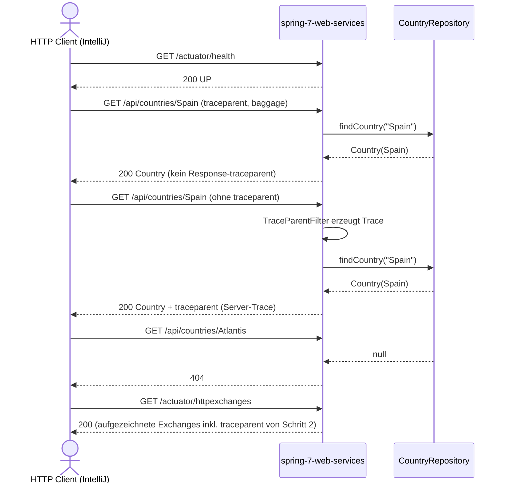

# REST-Flow: Country-Lookup über Spring MVC

Datei: `httpRequests/restRequest/country-flow/country-flow.http`

## Ziel

Den REST-Pfad (`CountryRestController` → `CountryRepository`, ohne Camel) als Flow prüfen:
Health-Vorbedingung, Country-Lookup mit eingehendem `traceparent` und `baggage`, derselbe Lookup
ohne `traceparent` (Server erzeugt einen neuen Trace), 404-Fall und die Gegenprobe über
`actuator/httpexchanges`.

## Ablauf

## Requests (in dieser Reihenfolge)

1. `health` – `GET /actuator/health`; Vorbedingung, `status=UP`.
2. `get country with an explicit traceparent` – `GET /api/countries/Spain` mit
   `traceparent: 00-{{traceId}}-{{spanId}}-01` und `baggage: testBaggage=hallo`; setzt
   `traceId`/`spanId`.
3. `get country without traceparent` – derselbe Call ohne `traceparent`; der Server erzeugt einen
   neuen Trace und liefert ihn als Response-Header `traceparent` zurück.
4. `unknown country returns 404` – `GET /api/countries/Atlantis`.
5. `verify the recorded exchange` – `GET /actuator/httpexchanges`; prüft, dass der Span aus
   Schritt 2 mit dem gesendeten `traceparent` aufgezeichnet wurde (Guard: bricht ab, wenn
   `traceId` fehlt).
6. `prometheus counter` – `GET /actuator/metrics/http.server.requests`; prüft, dass eine
   `uri`-Tag-Variante mit `/api/countries` existiert.

## Benötigte Globals

|         Global         |      gesetzt von       |     genutzt von      |
|------------------------|------------------------|----------------------|
| `traceId`              | Schritt 2 (Pre-Script) | Schritt 2, 5         |
| `spanId`               | Schritt 2 (Pre-Script) | Schritt 2            |
| `generatedTraceparent` | Schritt 3 (Response)   | optional (Debugging) |

## Asserts

- Health → `200`, `status=UP`.
- Spain mit `traceparent` → `200`, `name`/`capital`/`currency`/`population` korrekt, **kein**
  Response-`traceparent` (eingehender Trace wird nicht überschrieben).
- Spain ohne `traceparent` → `200`, Response-`traceparent` im Format
  `00-<32 hex>-<16 hex>-01`.
- Atlantis → `404`.
- `httpexchanges` → `200`, ein Exchange für `/api/countries/Spain` enthält den `traceId` aus
  Schritt 2 im Request-Header, Response-Status `200`.
- `metrics/http.server.requests` → `200`, `uri`-Tag mit `/api/countries` vorhanden.

## Hinweise

- Basis-URL ist `{{application-port}}` (`local` = 8080, `k8s` = 30080) aus
  `httpRequests/http-client.env.json`.
- Der Flow benötigt das Spring-Profil `local`: dort sind `management.httpexchanges.recording`,
  die OTel-Propagation (W3C) und das Log-Level für `RequestLoggingFilter` konfiguriert.
- `actuator/health` ist per `appconfig.request-logging.exclude-paths` vom Request-Logging
  ausgenommen; die übrigen Schritte erzeugen Debug-Logs des `RequestLoggingFilter`.
- Schritt 5 und 6 sind Gegenproben: Sie lesen nur Zustand, der von den vorherigen Schritten
  erzeugt wurde. Einzeln gestartet schlägt Schritt 5 bewusst fehl (Guard im Pre-Script).
- `baggage: testBaggage=hallo` wird vom `BaggageTaggingFilter` um `addedBaggage=echo` ergänzt und
  als Span-Attribut gesetzt; im Response ist das nicht sichtbar (nur in Logs/Tracing-Backend).

