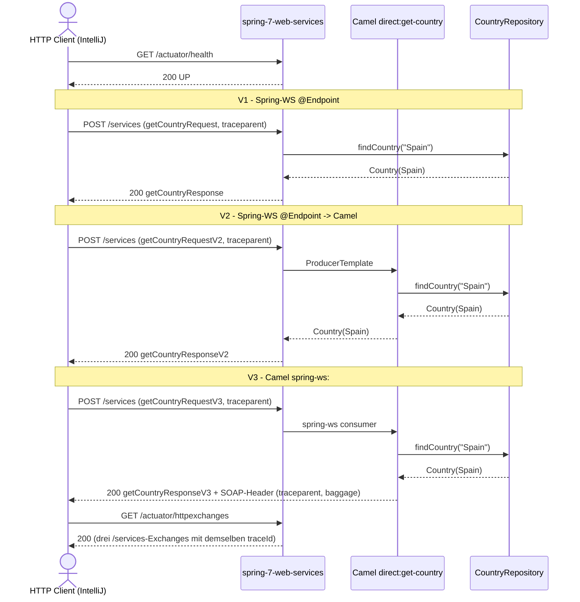

# SOAP-Flow: Country-Lookup über V1 / V2 / V3

Datei: `httpRequests/soapRequest/country-versions-flow/country-versions-flow.http`

## Ziel

Die drei SOAP-Integrationspfade mit identischem Payload vergleichen und dabei die
Trace-Propagation prüfen:

- **V1** – Spring-WS `@Endpoint` (`CountrySoapEndpoint`), direkt zum `CountryRepository`.
- **V2** – Spring-WS `@Endpoint` (`CountrySoapEndpointV2`), delegiert per `ProducerTemplate` an
  Camel `direct:get-country`.
- **V3** – Camel `spring-ws:` als HTTP-Einstiegspunkt, direkt in `direct:get-country`.

Jede Variante wird einmal mit eingehendem `traceparent` und einmal ohne (Server erzeugt einen
neuen Trace) aufgerufen. Alle drei Varianten laufen über denselben Endpoint `POST /services` und
unterscheiden sich nur im Envelope-Element.

## Ablauf

## Requests (in dieser Reihenfolge)

1. `health` – `GET /actuator/health`; Vorbedingung, `status=UP`.
2. `SOAP V1 with an explicit traceparent` – setzt `traceId`/`spanId`, Body
   `../getCountryRequest.xml`.
3. `SOAP V1 without traceparent` – Server-Trace, Response-Header `traceparent`.
4. `SOAP V2 with traceparent` – neuer `spanId`, gleicher `traceId`; Body
   `../getCountryRequestV2.xml`.
5. `SOAP V2 without traceparent`.
6. `SOAP V3 with traceparent` – neuer `spanId`, gleicher `traceId`; Body
   `../getCountryRequestV3.xml`.
7. `SOAP V3 without traceparent`.
8. `verify the recorded V1/V2/V3 exchanges` – `GET /actuator/httpexchanges`; prüft, dass genau
   drei `/services`-Exchanges den `traceId` aus Schritt 2 tragen.

## Benötigte Globals

|  Global   |      gesetzt von       |    genutzt von     |
|-----------|------------------------|--------------------|
| `traceId` | Schritt 2 (Pre-Script) | Schritt 2, 4, 6, 8 |
| `spanId`  | Schritt 2, 4, 6        | jeweiliger Request |

## Asserts

- Health → `200`, `status=UP`.
- V1/V2/V3 mit `traceparent` → `200`, jeweils eigenes Response-Element
  (`getCountryResponse` / `...V2` / `...V3`), `name=Spain`, `capital=Madrid`, `currency=EUR`;
  **kein** HTTP-Response-`traceparent` (eingehender Trace wird nicht überschrieben).
- V3 zusätzlich → SOAP-Header enthält `traceparent="00-<traceId>-…"` und `baggage="…"`.
- V1/V2/V3 ohne `traceparent` → `200`, HTTP-Response-`traceparent` im Format
  `00-<32 hex>-<16 hex>-01`.
- `httpexchanges` → `200`, genau drei `/services`-Exchanges mit dem `traceId` aus Schritt 2,
  alle mit Status `200`.

## Body-Strategie (Entscheidung für IntelliJ)

Die SOAP-Envelopes bleiben **externe XML-Dateien** (`../getCountryRequest*.xml`) und werden per
`< ../datei.xml` eingebunden:

- ein Envelope pro Version als Single Source of Truth, keine dreifache Inline-Pflege in sechs
  Requests;
- die bestehenden XML-Dateien bleiben unverändert und werden von den Einzelrequest-Dateien
  weiterverwendet;
- die Flow-Datei liegt im Unterordner, daher `../` als relativer Pfad zum `soapRequest/`-Ordner.

Für Bruno (Phase 2) ist diese Variante nicht direkt nutzbar, weil Bruno keine Datei-Referenzen im
Body kennt — dort muss der Body inline oder über ein Pre-Request-Script erzeugt werden.

## Hinweise

- Basis-URL ist `{{application-port}}` (`local` = 8080, `k8s` = 30080).
- Der Flow benötigt das Spring-Profil `local` (WSDL unter `/services`, `httpexchanges`-Recording,
  OTel-Propagation W3C).
- `SOAPAction: ""` und `Content-Type: text/xml; charset=utf-8` sind für alle Varianten identisch.
- Schritte 4, 6 und 8 setzen den `traceId` aus Schritt 2 voraus (Guard im Pre-Script).
- Der V3-SOAP-Header (`traceparent`, `baggage`) kommt vom Camel-`spring-ws:`-Consumer und ist der
  sichtbare Unterschied zu V1/V2 in der Response.

